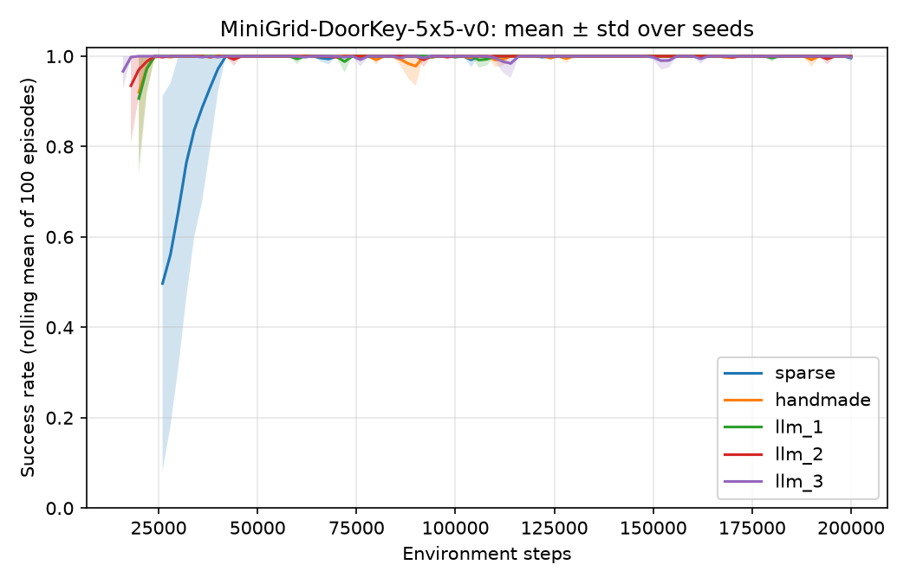
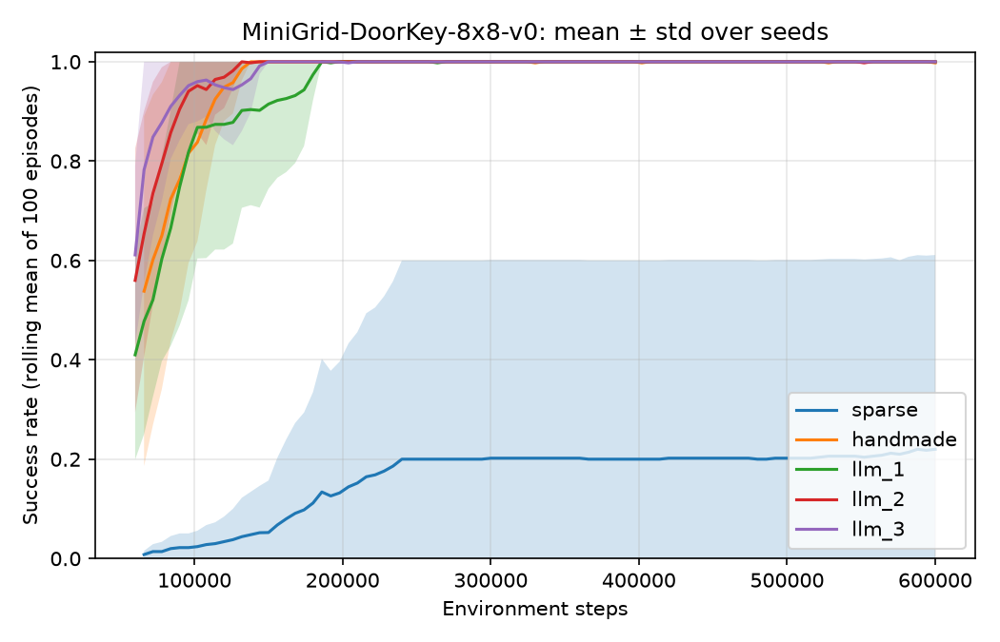

# Can a language model write useful rewards for reinforcement learning?

A small study on MiniGrid DoorKey with PPO (November 2026).

## Question

The original DoorKey reward is sparse: the agent gets a reward only when it
reaches the goal. I asked a language model to write dense reward functions and measured whether they help PPO learn faster, compared with the original reward and with a hand-written reward.

## Setup

- Environment: MiniGrid-DoorKey-5x5-v0 (and 8x8 to test generalization)
- Algorithm: PPO (Stable-Baselines3), 8 parallel environments, 200,000 steps on 5x5 and 600,000 on 8x8
- Rewards: sparse (original), handmade, llm_1, llm_2, llm_3
- LLM: GPT-6.1 (GPT-6.1-Sol-wm), 2026-11-05. Same prompt for the three rewards, each in a new conversation
  (see [prompts/prompt.md](prompts/prompt.md) and [prompts/answers/](prompts/answers/)).
- 5 seeds per reward. All curves use the ORIGINAL reward to measure success.
- Final evaluation: 100 unseen grids, deterministic policy.

## Results




*Steps to 80%*: training steps until the rolling success rate (100 episodes) reaches 80%, mean over 5 seeds.

| Reward   | 5x5 steps to 80% | 5x5 eval  | 8x8 steps to 80%  | 8x8 eval  |
|----------|-----------------:|----------:|------------------:|----------:|
| sparse   | 28k              | 99 ± 2 %  | 216k (1/5 seeds)  | 18 ± 35 % |
| handmade | 16.8k            | 99 ± 2 %  | 86.4k             | 91 ± 6 %  |
| llm_1    | 16.8k            | 84 ± 23 % | 99.6k             | 79 ± 11 % |
| llm_2    | 16k              | 79 ± 28 % | 81.6k             | 90 ± 7 %  |
| llm_3    | 14.4k            | 99 ± 1 %  | 70.8k             | 89 ± 3 %  |

Full tables: [results/](results/). Detailed answers: [notes.md](notes.md).

## What I learned

- All three LLM rewards speed up learning: 40–49 % fewer steps than sparse on 5x5. On 8x8, sparse fails with 4 seeds out of 5, while every shaped reward succeeds with all 5.
- The same prompt gives rewards of different quality. llm_3 is the best on both grids (faster than handmade), and llm_1 the weakest.
- No reward hacking was observed: every run solves 100 % of its training episodes. The low eval scores of llm_1 and llm_2 on 5x5 come from 1–2 seeds where the deterministic policy loops on unseen grids.
- Shaping matters more as exploration gets harder (8x8).

## Limitations

- Small, simple environment; 5 seeds; one prompt; one LLM.
- The LLM rewards are used exactly as generated, with no code fix. For example, llm_1 shapes with `Φ(s') − Φ(s)` instead of `γΦ(s') − Φ(s)`.
- The shaped bonus is not logged during training, so reward hacking is judged from success rates, episode lengths and the reward code.

## How to reproduce

```bash
pip install -r requirements.txt
python run_all.py
python analyze.py
python run_all.py --env MiniGrid-DoorKey-8x8-v0 --steps 600000
python analyze.py --env MiniGrid-DoorKey-8x8-v0 --steps 600000
```
